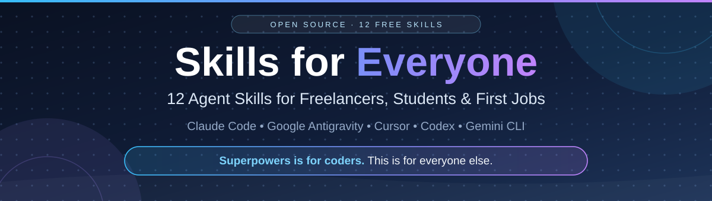

<p align="center">
  
</p>

<p align="center">
  <a href="LICENSE"></a>
  
  
  
  <a href="https://github.com/HaroonArshad-53/skills-for-everyone/stargazers"></a>
</p>

# Skills for Everyone — Agent Skills for Claude Code, Antigravity, Cursor, Codex & Gemini CLI

**Free, open-source Agent Skills (`SKILL.md`) for freelancers, students, and first-job seekers — the people most AI skill collections forget.**

Most skill repos are built for senior software engineers: test-driven development, code review, deployment pipelines. Useful — if you already have a tech job. This repo is the opposite end: 12 focused skills for getting your **first client, first project, first grade, and first job**, written in simple English, installable in 30 seconds, and honest by design — every skill has hard rules against inventing experience, fake metrics, and fabricated references.

> *Superpowers is for coders. This is for everyone else.*

---

📖 **New here?** Follow the full [Setup Guide](docs/SETUP.md) (per-agent steps, Windows notes, how to verify it worked, troubleshooting) and see [Examples & Expected Results](docs/EXAMPLES.md) — a full use case with the proper result for all 12 skills.

## ⚡ Install in 30 seconds

```bash
git clone https://github.com/HaroonArshad-53/skills-for-everyone.git
cd skills-for-everyone

# Pick your agent + your bundle
python3 install.py --tool claude --bundle freelancer
python3 install.py --tool antigravity --bundle student
python3 install.py --tool cursor --bundle all
```

Then **restart your agent** (or start a new chat) and just ask normally — the right skill loads by itself:

> *"Analyze this Upwork job post and tell me what to ask the client"* → `client-brief-analyzer` loads
> *"Grill me for my SOC analyst internship interview"* → `interview-griller` loads
> *"I have 1.5 hours a day, make me a 30-day Python plan"* → `learn-in-30-days` loads

**Supported agents and install paths** (standard Agent Skills format — the same `SKILL.md` works everywhere):

| Agent | Default skills directory |
|---|---|
| Claude Code | `~/.claude/skills/` |
| Google Antigravity | `~/.gemini/antigravity/skills/` — Antigravity 2.0 may use `~/.gemini/config/skills/` instead; if skills don't appear, re-run with `--path ~/.gemini/config/skills` |
| Cursor | `~/.cursor/skills/` |
| OpenAI Codex CLI | `~/.codex/skills/` |
| Google Gemini CLI | `~/.gemini/skills/` |
| Any other agent | Use `--path /your/skills/dir` — or copy any `skills/<name>/` folder manually |

Installer options: `--list` (see all skills), `--dry-run` (preview, copies nothing), `--force` (overwrite older installs). No dependencies — Python 3 only.

You can also use the community skills CLI: `npx skills add HaroonArshad-53/skills-for-everyone`

---

## 💼 Bundle 1: Freelancer Skills

For freelancers on Upwork, Fiverr, Contra, or working with direct clients — from first message to final payment.

| Skill | What it does | Try asking |
|---|---|---|
| [client-brief-analyzer](skills/client-brief-analyzer/SKILL.md) | Turns a messy client message or job post into a clear brief: scope, missing info, red flags, questions to ask | *"What is this client actually asking for?"* |
| [proposal-writer](skills/proposal-writer/SKILL.md) | Writes a specific, non-spammy proposal from the real job post and your real proof — never invented experience | *"Write my proposal for this job post"* |
| [project-scope-planner](skills/project-scope-planner/SKILL.md) | Acts as project manager: divides an accepted job into client-approved milestones, tasks, dependencies, and an honest timeline | *"Divide this project into milestones"* |
| [pricing-calculator](skills/pricing-calculator/SKILL.md) | Calculates Low / Recommended / High quotes with platform fees, rush, and revisions — includes a real Python calculator in [scripts/pricing.py](skills/pricing-calculator/scripts/pricing.py) | *"How much should I charge for this?"* |
| [professional-email](skills/professional-email/SKILL.md) | Rewrites rough or mixed-language drafts (Roman Urdu, Hinglish, broken English) into professional emails — payment follow-ups from polite to firm | *"Make this payment follow-up professional"* |
| [portfolio-case-study](skills/portfolio-case-study/SKILL.md) | Turns finished work into a portfolio case study + LinkedIn post, using only your real results | *"Make a case study from this project"* |

## 🎓 Bundle 2: Student & First-Job Skills

For school and university students, final-year projects, and fresh graduates hunting a first job or internship.

| Skill | What it does | Try asking |
|---|---|---|
| [study-any-topic](skills/study-any-topic/SKILL.md) | Teaches any topic simply, with a real-life example, a 5-question quiz, and flashcards | *"Explain this topic like I'm a beginner, then quiz me"* |
| [fyp-project-manager](skills/fyp-project-manager/SKILL.md) | Plans a final-year project like a manager: interview → `PROJECT-PLAN.md` → weekly tasks with visible deliverables → supervisor updates | *"Plan my FYP and divide it into weekly tasks"* |
| [assignment-researcher](skills/assignment-researcher/SKILL.md) | Source-first assignment research: outline, tagged facts, verified references only — never fabricated citations | *"Help me research this assignment, APA style"* |
| [interview-griller](skills/interview-griller/SKILL.md) | Mock interviewer: asks one tough question at a time, scores your answer honestly, teaches the stronger version | *"Grill me for this internship interview"* |
| [resume-builder](skills/resume-builder/SKILL.md) | Builds an ATS-friendly resume from messy notes, tailored to a job post — with an honesty audit of every claim | *"Tailor my resume to this job post"* |
| [learn-in-30-days](skills/learn-in-30-days/SKILL.md) | A realistic 30-day learning plan sized to your actual hours per day, with weekly projects and self-tests | *"Make me a 30-day plan to learn Python"* |

---

## 🎬 See it in action

Full use cases with the proper result for **all 12 skills**: [docs/EXAMPLES.md](docs/EXAMPLES.md). Two favourites:

**Pricing, with real maths (not AI guessing):**

```bash
$ python3 skills/pricing-calculator/scripts/pricing.py --hours 20 --rate 15 --fee 10 --rush week --revisions 3
Base: 20h x 15 = 300.00
After rush x1.25 and revisions x1.10: 412.50 (amount you must keep)
Low: quote 389.58 -> you keep 350.63 after 10% fee
Recommended: quote 458.33 -> you keep 412.50 after 10% fee
High: quote 572.92 -> you keep 515.63 after 10% fee
```

**A skill doing its job** — you paste a vague job post, `client-brief-analyzer` answers:

> **Verdict: Workable after questions.** Missing: which pages are broken, current platform and hosting access, what "ASAP" means in days, and the actual budget range. Red flag: "more work later" is being used to justify a low first budget — quote this job on its own value.

---

## 🧠 How Agent Skills work (30-second version)

A skill is a folder with one `SKILL.md` file: a name, a one-paragraph description of *when* to use it, and step-by-step instructions in plain English. Your agent reads only the descriptions at startup. When your request matches one, it loads that skill's full instructions and follows them — the workflow, the rules, and the output format — every time, without you re-explaining. Skills in this repo can also carry small scripts (like the pricing calculator) for jobs that need exact maths instead of an AI estimate.

## 📏 The honesty rules (why these skills are different)

Generic AI happily invents a 5-star rating for your proposal, a fake citation for your assignment, and a 40% sales increase for your case study. Every skill here is built to refuse that:

- **proposal-writer / resume-builder** — never invent experience, clients, metrics, degrees, or certifications
- **assignment-researcher** — a reference that can't be verified doesn't go in the list; gaps are reported, not filled
- **portfolio-case-study** — a true small result beats a fake big one
- **interview-griller** — honest scores; a kind lie sends you into a real interview unprepared
- **pricing-calculator** — real script, real maths, assumptions printed next to every quote

## 🆚 How this compares

| | This repo | Coding skill frameworks (Superpowers etc.) | Mega-collections (1,000+ skills) | Official document skills |
|---|---|---|---|---|
| Built for | Freelancers, students, first jobs | Senior software engineers | Everyone, generally | Office document work |
| Skills | 12, focused | ~20, deep coding methodology | 1,000+, mixed quality | 17 |
| Language | Simple English, beginner-first | Technical | Technical | Technical |
| Anti-fabrication rules | Built into every skill | N/A | Varies per skill | N/A |
| Install | 1 script, 5 agents | Plugin marketplace | Installer CLI | Plugin marketplace |

## ❓ FAQ

**Are these Claude skills only?**
No. They use the open Agent Skills format (`SKILL.md`), so the same folders work in Claude Code, Google Antigravity, Cursor, OpenAI Codex, and Gemini CLI. Install paths for each are in the table above.

**I'm not technical. Can I use this?**
Yes — that's the point. If your AI tool supports skills, installation is one command (above), and after that you just chat in plain language. The skills themselves are written in simple English.

**Can I use just one skill?**
Yes. Copy any single `skills/<name>/` folder into your agent's skills directory, or use the installer and delete what you don't need.

**How do I make my own skill?**
Copy any skill folder here as a template: keep the folder name and the `name:` in `SKILL.md` identical (lowercase, hyphens), write a description that clearly says *when* to use it, and keep the body under 500 lines. Then run the validator: `python3 scripts/validate_skills.py`. See [CONTRIBUTING.md](CONTRIBUTING.md).

**Are the skills checked in any way?**
The structure of every skill in this repo is validated by [scripts/validate_skills.py](scripts/validate_skills.py) — frontmatter, required sections, description length, and bundle/README consistency. Run it yourself: it should report `OK - 12 skills validated, 0 problems.`

## 🗺️ Roadmap

- [x] v1.0 — Freelancer bundle (6 skills) + Student & First-Job bundle (6 skills)
- [x] Cross-agent installer (Claude Code, Antigravity, Cursor, Codex, Gemini CLI)
- [ ] Office & admin bundle (meeting notes, reports, spreadsheets for non-coders)
- [ ] More languages for professional-email (Spanish, Bengali, Arabic drafts)
- [ ] Community skills — PRs welcome, see [CONTRIBUTING.md](CONTRIBUTING.md)

## 🤝 Contributing

New skills and fixes are welcome — one skill per PR, follow the template and the honesty rules, and make sure `python3 scripts/validate_skills.py` passes. Details in [CONTRIBUTING.md](CONTRIBUTING.md). Full skill index: [CATALOG.md](CATALOG.md).

## ⭐ Support

If a skill here helped you win a client, pass a viva, or land an interview — a star helps the next freelancer or student find it. Found a skill that doesn't trigger, or gives a wrong output? Open an issue with your agent name and the prompt you used.

## 📄 License

MIT — see [LICENSE](LICENSE). Use the skills anywhere, including in commercial work.
